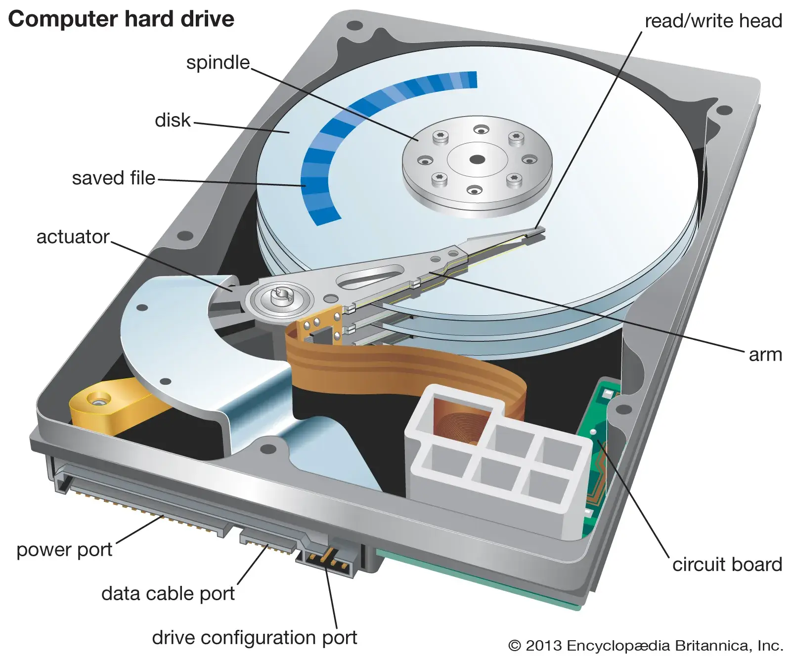
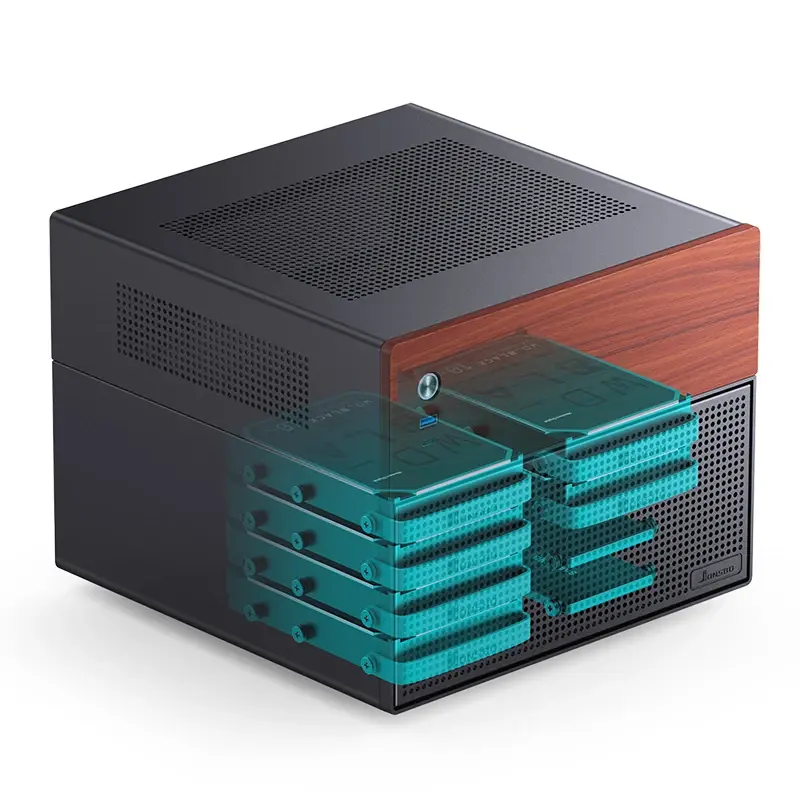
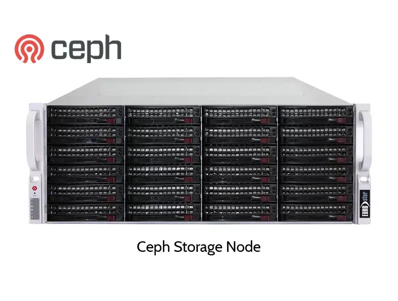
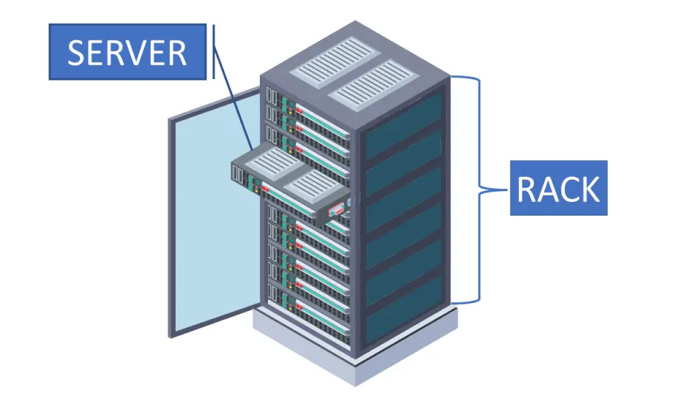

+++
title = "Virtual Private Servers and Network Attached Storage"
description = "Introduction to running software on cloud infrastructure and storing big data on dedicated storage hosts."
date = 2026-11-05
lastmod = 2026-11-05
writers = ["Sam Neisewander"]
tags = ["self-hosting", "cloud"]
draft = false
+++

# Overview

This meeting covers two different, somewhat related topics related to cloud
infrastructure and self-hosting.

## Virtual Private Servers

What's in a server? If you've ever built a desktop computer, you know it will
have:

- A central processing unit (CPU)
- Some RAM, probably DDR4 or DDR5 for newer machines
- Some disk, either in the form of an SSD or HDD
- Possibly a graphics processing unit

Similarly, compute nodes in a server rack will have similar components. Of
course, a rack in a datacenter may contain roughly 30-40 nodes, and a datacenter
may have 10s or 100s of racks.

Deploying a server is costly. First you must select and purchase the components,
then build the server, then pay for power and networking just to get it running.
Once it runs, you must spend time configuring the operating system and services,
and more time fixing problems when they occur. You must also replace components
every few years when their performance starts to wane or hardware failures
occur.

There exists an alternative: rent computing resources from a datacenter. A
datacenter can provision you some of its computing resources, allocation some
amount of CPU cores, disk space, memory, and network bandwidth for a monthly
fee. Your "virtual private server" can then be accessed via a remote shell like
`ssh`, and configured to your liking. You can also be provisioned an IPv4
address, which makes hosting public services much easier. Another neat thing
about renting compute is that you aren't responsible for hardware failures. Much
of the risk of rolling your own hardware is outsourced to the cloud provider.

Furthermore, developers wanting to host some software application typically do
not need the resources of an entire server. A pastebin, for example, is a really
handy piece of software with negligible resource consumption. Chat or proxy
servers similarly punch above their weight class in terms of the ratio between
resource consumption and utility. If you intend to host a handful of these kinds
of applications, should you rush to build your own server?

This choice really depends on the nature of your workload. Often, it makes more
economical and logistical sense to run a lightweight service using cloud
compute. Factors such as compute price, privacy, security, network I/O latency,
and availability might play into your decision.

The rest of this section will discuss what goes into setting up a virtual
private server using a cloud provider.

### VPS providers

First, you must select a provider. The biggest tech giants offer
infrastructure-as-a-service platforms, like Amazon Web Services, Google Cloud
Platform, and Oracle Cloud. There also exist smaller "mom and pop" hosting
providers with slimmer offerings. An example is Vultr, a smaller hosting
provider that Professor Bui uses to host some of his services.

When you create an account with a hosting provider, you will have to add a
payment method so they can charge you as you use compute resources. This
obviously requires some diligence on your part so that you don't get stuck with
a runaway computing bill. Of course, with a VPS, typically your usage is rate
limited based on your hardware configuration, but just make sure you carefully
look at what the costs will be. Typically, a 1vCPU VPS with 5GB of RAM and a
20GB disk goes for $5/mo.

### Hardware configuration

After you create an account with a hosting provider and set up your billing, you
can create a compute instance (the VPS). Compute instance come in all kinds of
shapes and sizes, so much so that the options can be overwhelming at first. This
is a good time to step back and think about what you are actually planning to
run on the system: get a sense of how much memory, disk, and CPU resource
consumption your application requires. If you aren't sure, try provisioning a
lightweight VPS first, and measure your workload using profiling utilities like
`top`. It is easier to expand a small VPS to include more resources, but
annoying to take a large VPS and make it smaller (especially when adjusting disk
sizes).

Most hosting providers will have some kind of catalog describing their "instance
types". These catalogs typically organize instance types based on the kind of
workload they are best suiting for (i.e. memory intensive vs CPU intensive vs.
disk or network I/O intensive). In a given category, there will be a range of
options with different performance characteristics at different price points.
Try to narrow down your options based on one or two hardware criteria to make
things simpler.

### Software configuration

Once you select your instance type, you'll have to pick a host operating system
for your VPS. This is mostly a matter of taste, though some workloads may be
better suited to an application specific distro. Generally speaking, a standard,
general-purpose Linux operating system like Debian or Ubuntu will do the trick.

### Network configuration

Make sure your VPS comes with a public IPv4 address. This makes the VPS
accessible by other devices over the internet, which is essential for hosting
any services.

### SSH Keys

VPS provides will have a web-bashed shell you can use to access you compute
instance, but typically it is much easier to install an SSH key on the remote
server and use `ssh` to access it over the internet. Here is a
[complete guide on how to set this up](https://docs.vultr.com/how-do-i-generate-ssh-keys/),
but let's consider a basic example here.

Say you use `ssh-keygen` on your laptop:

```bash
❯ ssh-keygen
Generating public/private ed25519 key pair.
Enter file in which to save the key (/Users/samneisewander/.ssh/id_ed25519): vultr
Enter passphrase for "/Users/samneisewander/.ssh/vultr" (empty for no passphrase):
Enter same passphrase again:
Your identification has been saved in /Users/samneisewander/.ssh/vultr
Your public key has been saved in /Users/samneisewander/.ssh/vultr.pub
The key fingerprint is:
SHA256:y90O5BMYgBElMMjv7TQGKBQGdNsWYhhRhWF/piFQ9Qo samneisewander@kurama.local
The key's randomart image is:
+--[ED25519 256]--+
|=OXXOOo          |
|o+=o*.o.         |
|. oE = +.        |
|.. o+ *  o       |
|. . oo  S o      |
|   . = . = o     |
|    + . o = .    |
|     .     +     |
|            .    |
+----[SHA256]-----+
```

Here I have named my key pair `vultr`, producing two key files:

- The public key file in `~samneisewander/.ssh/vultr.pub`
- The private key file in `~samneisewander/.ssh/vultr`

I can copy and paste the contents of `vultr.pub` into my Vultr dashboard (or
whatever hosting provider I use, they all provide similar features), and
configure my VPS to use it.

On my laptop, I'll add the following lines to my `~samneisewander/.ssh/config`:

```config
Host vultr-vps
  HostName 149.42.42.131 # This is an example IP, you would replace this with the actual one.
  IdentityFile ~/.ssh/vultr
  User root
```

...creating a new alias called `vultr-vps` for my VPS so that my `ssh` client
knows the IP address, private key, and user I want to use when accessing my VPS
with `ssh vultr-vps`.

### Application layer services

So... what to run on the VPS now that it's set up?

Let's walk through a simple application that will help you get your feet wet
with Linux: [ssh-chat](https://github.com/shazow/ssh-chat).

`ssh-chat` is a chat server that allows users from the public internet to
connect to a chat room and send messages via their `ssh` client. This
application poses a couple interesting challenges:

- `ssh` clients connect to port `22` by default. This makes sense, because
  `sshd`, the daemon service running on our VPS, _listens for incoming ssh
  connections_ on port 22. When it receives one, it forks a instance of a
  `shell` which you can use to manage your VPS.
- However, we _don't want our users' `ssh` clients to connect to `sshd`_!
  Instead, we want them to connect to our _chat server_.
- That means we have to configure our _chat server_ to listen on port `22`, and
  our `sshd` to listen on some other port.

How can we configure `sshd` to listen on a non-standard port? Most applications
on a Linux machine store their configuration files in `/etc`, and typically you
need to be `root` to modify those configurations. Luckily, we have already
configured our remote shell to login as `root` when we `ssh` into `vultr-vps`
using our registered key pair. Therefore, from the VPS, we can run
`vim /etc/ssh/sshd_config` and edit the lines:

```
Port 2222
PermitRootLogin prohibit-password
PubkeyAuthentication yes
PasswordAuthentication no
```

After running `systemctl restart sshd`, our daemon should only accept remote
shell connections on port `2222`. Therefore, we need to update our ssh config to
use the new port:

```config
Host vultr-vps
  Port 2222
  HostName 149.42.42.131 # This is an example IP, you would replace this with the actual one.
  IdentityFile ~/.ssh/vultr
  User root
```

But wait... now when we run `ssh vultr-vps`, it hangs. Why?

The firewall.

Yep. Linux systems usually ship with some kind of software firewall that blocks
unwanted incoming traffic. The one installed on our VPS is likely `ufw` (short
for uncomplicated firewall), and is configured out of the box to only permit
incoming traffic on port `22` (for remote shells), NOT port `2222`. So we need
to permit traffic on that port. But how can we manage that when we can't even
`ssh` into the VPS?

The solution is to use the web shell provided by the hosting provider's
dashboard. These shells do not operate over ssh, but rather make use of a serial
connection to the VPS, which allows us to access our machine even in these
(surprisingly common) "oops I locked myself out of my own computer" situations.

With a root shell using the web dashboard, we can run `ufw status` to see what
ports are open on our VPS and then `ufw allow 2222` to permit traffic to enter
our VPS on the new `sshd` port. After running `ufw reload`, the changes will
take effect and we can `ssh` into our VPS normally again.

Now, time for the chat application. Let's curl the
[binary](https://github.com/shazow/ssh-chat/releases/tag/v1.10) into our home
directory:

```bash
curl -sLO https://github.com/shazow/ssh-chat/releases/download/v1.10/ssh-chat-linux_arm.tgz
```

Extract it using `tar`:

```bash
tar -xzf ssh-chat-linux_arm.tgz
```

...and finally run the application:

```bash
./ssh-chat/ssh-chat --bind ":22"
```

You'll notice the application complains because we haven't given it a key pair
to use for it's identity. Let's make one using `ssh-keygen` called `chat`, and
rerun the program:

```bash
./ssh-chat/ssh-chat --bind ":22" -i /root/.ssh/chat
```

Now the application should run! Try having your friends `ssh` into your VPS
using its public IP address.

One caveat is you might notice your laptop complains when _you_ try to `ssh` in.
This is because your laptop has saved the public key signature of the VPSs
`sshd` key pair back when that was still hosted on port `22`. Now that you are
connecting to an `ssh` server that is advertising a _different_ key pair, but on
the same host and port, your client thinks something is afoul and will scream
bloody murder and refuse to connect. Of course, we know that the reason for this
change is because we switched which application and key pair are listing on that
port, and that nobody is trying to man-in-the-middle us. We can stop our client
from producing these warnings by editing `~/.ssh/known_hosts` and removing the
offending entries from the bottom of the file.

Congratulations, you've just deployed your first service in a cloud VM!
Hopefully, this mini project is a gateway drug to the rabbit hole that is
self-hosting and distributed computing in the cloud.

## Network Attached Storage

Over the course of your lifetime, how much digital junk will you hoard?

How much data do you generate per year? A few gigabytes for photos and videos on
your cell phone perhaps? Maybe tens or hundreds of documents, spreadsheets,
downloads, game saves, text messages, or other application data? If you think
about it for moment, could you quantify it?

People generate loads and loads of data. Some of it they care about, like photos
and text messages. Some of it they could care less about, like their browser
cache. Most people take the longevity of that data for granted, completely
oblivious to how or where it is stored until it becomes a big problem.

Does this sound familiar?

- Mom stores her photos in the cloud
- Mom's phone stopped taking automatic backups when she ran out of cloud storage
- Mom ignored the notifications because a larger storage plan costs more
- Mom phone is swallowed by a shark.
- Photos gone :(

This problem stands to be exacerbated as more and more of people's lives are
represented using digital means. These days, it is natural to store critical
things like tax documents, health records, government documents, leases, payment
histories, etc. etc. digitally. The problem of data integrity, sovereignty, and
privacy is more and more poignant every day.

Turning the focus to corporate concerns, companies are also responsible for
storing large amount of data. Media companies, for example, ingest large amounts
of bulky footage which needs to be processed, transcoded, and archived. Software
companies need to archive software releases and the dependencies needed to build
them in order to support their customers whose problems need to be reproduced
and fixed on a particular release. In these examples, we need to think about
scaling storage capacity to handle these demanding workloads.

Generally speaking, the on-device storage on personal computing devices is not
enough to meet these demands. A scalable solution is necessary. Enter **network
attached storage**.

The basic strategy for a network attached storage server is to take a bunch of
high-capacity storage devices, stuff them in a box, and hook that box up to the
network so that other devices with limited storage capacity can access a much
larger pool of persistent storage. Self-hosted and cloud storage services share
a similar architecture, so this article will review the levels of abstraction
needed to understand these systems.

When building storage server, the architecture addresses these concerns:

- How much data can be meaningfully stored (Capacity)
- How resistant is the data to hardware failures (Integrity)
- How easily can data be accessed (Availability)

The discussion will address these concerns.

### Storage media

A storage server is built upon several storage devices, so the first decision
that needs to be made is which one to use.

There are many kinds of storage media:

- [Tape drives](https://en.wikipedia.org/wiki/Tape_drive), used for massive
  archival storage where read/write performance does not matter.
- [Hard drives](https://en.wikipedia.org/wiki/Hard_disk_drive), the defacto
  standard for enterprises and data centers for fast contiguous reads/write
  performance, capacity, and long term storage
- [Solid state drives](https://en.wikipedia.org/wiki/Solid-state_drive), a
  modern, compact storage medium with extremely fast random access.

...etc. For a typical storage server, some mixture of hard drives (HDDs) and
solid state drives (SSDs) are used depending on the workload.

Hard drives are mechanical devices that read and write data on spinning platters
via a magnetized head. This mechanical design has some implications:

- Hard drives experiences mechanical wear. Eventually, sectors will becomes
  unreadable or the head may crash into the platters, destroying the drive and
  any data it contains.
- As a result of the head physically rotating around _contiguous_ sectors of the
  drive, these devices are best suited for _contiguous_ workloads, like media
  streaming or archival storage.
- Hard drive technology has been around since the 1970s, and devices resembling
  those used today have been around since at least the 2000s. As a result, hard
  drives are (usually) cheap, abundant, and predictable.
  

Solid state drives make use of NAND flash technology to program and erase bits
of data. Since these devices do not have moving parts, they do not experience
mechanical wear like hard drives; instead, the NAND deteriorates as it is
programed repeatedly. This has some implications:

- SSDs are great for extremely fast random access, making them suitable for
  hosting databases or large quantities of small files. Most personal devices
  like cell phones and laptops use SSDs, since their compact form factor and
  performance is suitable for those use cases.
- SSDs exhibit great longevity, especially if they support read-heavy and
  write-light workloads, since they only wear when they are written.
- SSDs are more expensive because NAND flash is expensive.

### Building the server

Since storage servers are mostly doing network and disk I/O, the other
components in the system do not need to be high-performance. Essentially any
reasonable CPU, motherboard, power-supply, etc. will do. Most people building a
personal NAS will repurpose an old desktop computer and throw some hard drives
in it. A fancier option is to use a NAS chassis with (possibly hot-swappable)
drive bays, like this: 

This kind of "standalone" form factor is generally what you'll see for
self-hosted storage servers. Enterprise solutions will probably ship a storage
server in the form of a server rack, like this:


Scaling further, we can have a whole rack full of storage servers, along side
other compute servers or network gear: 

This is the kind of configuration typical of a high-performance computing
cluster like the CRC or a datacenter used for cloud-based services like Google
Cloud Platform or AWS. Notice that both are fundamentally just a bunch of hard
drives stuffed in a box.

### Storage pools

Consider a single storage server (either a single rack server or a standalone
box). At this point, the _capacity_ concern has been addressed; many
high-capacity drives are waiting, ready to be accessed over the network by other
machines. However, the _integrity_ problem is still lingering. What happens in
the event of a _drive failure_, perhaps caused by a _head crash_? Without a more
sophisticated design, the data is simply lost. Let us address this concern next
by arranging our hard drives into _storage pools_.

A storage pool is a software abstraction of a collection of hard drives. This
abstraction is implemented by a _filesystem_ like
[ZFS](https://en.wikipedia.org/wiki/ZFS). Arrange hard drives in a software
abstraction allows the operating system to reserve some physical drive space for
redundancy mechanisms like [RAID](https://en.wikipedia.org/wiki/RAID) and save
snapshots of the state of the storage pool which can be restored later in the
event of data loss. Typically, administrators (that's you!) will create storage
pools with a certain workload in mind; for example, an administrator might
create a pool of 4 SSDs which will later be used to store a database for a
instance of an image server like [Immich](https://immich.app/).

### Operating systems

Network storage servers, like other modern servers, have an operating system.
There exist operating systems tailored for this use-case, such as
[TrueNAS](https://www.truenas.com/) or [Unraid](https://unraid.net/). Of course,
general purpose operating systems like [Debian](https://www.debian.org/) will
also do the trick (albeit with more configuration). A nice choice for
self-hosting is TrueNAS Community, which runs on Debian and ZFS under the hood.
It provides a handy web dashboard with lots of observability metrics, a curated
package repository for running services with Docker, and a VM hypervisor.
Installing TrueNAS is just like installing any other operating system; here is a
[guide](https://www.truenas.com/docs/scale/gettingstarted/install/installingscale/)
for this.

### Application layer services

Finally, with the storage server built, operating system installed, and storage
pools configured, it is time to spin up an application on the server! The
simplest thing to run is a _file server_, like
[Samba](<https://en.wikipedia.org/wiki/Samba_(software)>) or
[NFS](https://en.wikipedia.org/wiki/Network_File_System). A file server
facilitates file transfers between the storage server and other devices by
"mounting" a directory from the file server on another device. To the client
device, a mounted directory looks and feels like any other directory on the
system, but when file are read from or written to it, they are actually being
transmitted over the network to the file server.

While this strategy works, it can be difficult for civilian users to understand
and configure. Instead, it might make more sense to run a more complicated
application on the storage server that provides users with conveniences like a
_web interface_, a _mobile app_, and _user accounts_. An example mentioned
earlier is [Immich](https://immich.app/), a self-hosted clone of Google Photos
with features like automatic backups from a cell-phone, machine-learning face
recognition, single sign on via Google accounts, and shared albums/libraries.
The application layer services you choose to deploy depend on the needs of your
users.

### Self-hosted or Cloud?

A very common problem that appears everywhere in software and in life is the
decision to solve a problem yourself or pay someone else to solve the problem
for you.


Purchasing Google Photos costs:

- $2/month for 100GB
- That's it

Self-hosting costs:

- Hundred of dollars in hardware (which breaks and needs to be replaced every
  5-10years)
- Tens of hours of time configuring and maintaining the system when problems
  arise
- _Risk_, since _you_ are responsible for data loss, failures, outages. This is
  also often overlooked when doing price estimates.

Of course, a self-hosted solution nets you privacy, sovereignty, and control.
Some companies would pay a high premium for stronger guarantees that their
intellectual property will not be leaked or stolen, which makes self-hosting
more compelling. Also, the data privacy and price factors are influence by LLMs
and the ongoing massive datacenter scale out, but I will spare you the soapbox
on that.

Another factor is _availability_. Network I/O is expensive, but not all network
operations are equal. Consider the media company example: editors may be editing
footage off of the NAS and expect relatively low latency, which they certainly
will not get from the cloud. It could also be the case that massive cloud data
storage solutions price not only capacity but also _bandwidth_, that is, how
much data you are downloading and uploading. In this case, a self-hosted
solution makes much more economical sense.

### Further reading (watching)

- [Linus Tech Tips - He Needs a NAS](https://www.youtube.com/watch?v=QX6eefTta14)
- [Switch and Click - Google Tried to Charge Me $3,600/yr... I Built My Own Server Instead](https://www.youtube.com/watch?v=8_1OBOeuBsA)
- [Lawrence Systems](https://www.youtube.com/@LAWRENCESYSTEMS)
